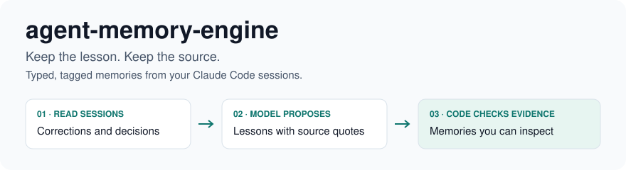
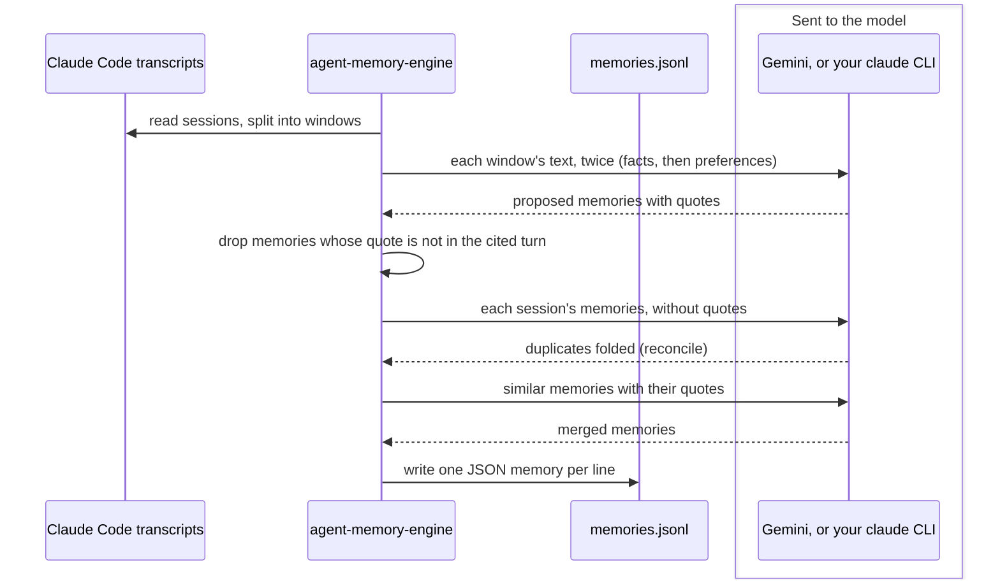

<picture>
  <source media="(prefers-color-scheme: dark)" srcset=".github/assets/banner-dark.svg">
  
</picture>

[](LICENSE)
[](pyproject.toml)
[](docs/install.md)

The corrections and decisions you give a coding agent can disappear into past conversations, leaving you
searching transcripts or repeating yourself. agent-memory-engine turns your Claude Code sessions into
memories you can inspect, filter and choose to reuse, with a checked source quote attached to each one.

The package and command name are `tetriz-agent-memory-engine`.

## Contents

- [What it does](#what-it-does) describes the commands and their boundaries.
- [Install](#install) covers the release package and command names.
- [Quick start](#quick-start) runs a sample without a model account.
- [Use your own sessions](#use-your-own-sessions) previews local data before extraction.
- [How it works](#how-it-works) shows what reaches the model.
- [Reference](#reference) links the flags, format and measurements.
- [Limitations](#limitations) explains what to check before relying on a memory.
- [Project](#project) covers compatibility, tests, contributions and licensing.

## What it does

| Command or output | What you can do |
|---|---|
| `tetriz-agent-memory-engine sessions` | Preview the sessions and windows a run would read, without model calls |
| `tetriz-agent-memory-engine run` | Extract facts and preferences, then merge them into a ranked `memories.jsonl` |
| `tetriz-agent-memory-engine extract` and `merge` | [Run one extraction arm at a time](docs/usage.md#run-one-arm-at-a-time) |
| The Python API | [Use the pipeline from code](docs/usage.md#use-the-python-api), with a supported provider or your own `ModelClient` |
| `memories.jsonl` | [Filter memories by tag](#pick-memories-by-tag), scope, review status and evidence |

Each retained memory has a type, tags and source evidence. Code checks that each quoted passage appears
in its cited turn and belongs to the cited speaker. That verifies the citation, not the truth of the
memory or whether it is still applicable. [The recorded example](#try-a-recorded-run-no-api-key-needed) shows the result.

### What it does not do

- It does not write memories into `CLAUDE.md` or any agent. You choose what to load.
- It reads Claude Code sessions only, not other agents' transcripts.
- It does not update memories as facts change. Each run is a snapshot.

## Install

Install the CLI from the GitHub release with [uv](https://docs.astral.sh/uv/).

```sh
uv tool install https://github.com/tetriz-ai/agent-memory-engine/releases/download/v0.1.0/tetriz_agent_memory_engine-0.1.0-py3-none-any.whl
tetriz-agent-memory-engine --help
```

[Installation](docs/install.md) also covers the Python API and building from source.

## Quick start

You need macOS or Linux, Git and [uv](https://docs.astral.sh/uv/) for the source example.
uv supplies Python 3.12 or newer when needed. This sample uses synthetic sessions and recorded model
answers, so it needs no API key or Claude Code login.

```sh
git clone https://github.com/tetriz-ai/agent-memory-engine
cd agent-memory-engine
uv sync --locked
```

### Try a recorded run, no API key needed

From the checkout above, replay fixed model answers for two synthetic sessions. This needs no
Gemini API key, `claude` login or personal transcripts, and sends no data to a model. The output
demonstrates the pipeline and memory format, not model accuracy.

```sh
uv run python examples/extract-from-a-recorded-session/main.py | head -n 7
```

```text
2 sessions, 5 memories, ok=True

[decision] In shop, run pnpm install --frozen-lockfile in each worktree instead of symlinking node_modules from the main checkout, because Turbopack refuses a node_modules outside the project root.
[failed-attempt] Generating a fresh idempotency key for each billing retry attempt double-charged customers.
[convention] Always reuse the original idempotency key on billing retries.
[caution] The billing retry path built a new request without the original Idempotency-Key header, so the payment provider treated each retry as a new charge.
[preference] Phrase code review comments as questions, not directives.
```

<details>
<summary>The rest of the output: without <code>| head -n 7</code>, it also prints the first memory as JSON</summary>

```json
{
  "memory_id": "5f2d3aa8f126b49dd0bf6f96",
  "statement": "In shop, run pnpm install --frozen-lockfile in each worktree instead of symlinking node_modules from the main checkout, because Turbopack refuses a node_modules outside the project root.",
  "description": "The worktree setup script now removes a stale node_modules symlink and installs with pnpm. The same holds for any repo in the dev org that builds with Turbopack.",
  "type": "decision",
  "secondary_type": "convention",
  "scope": {
    "identified": {
      "level": "repo",
      "ref": "dev/shop"
    },
    "applicable": {
      "level": "org",
      "ref": "dev"
    }
  },
  "tags": {
    "domain": "developer-tooling",
    "activity": "coding",
    "component": [
      "worktree-setup"
    ],
    "tech": [
      "pnpm",
      "turbopack"
    ],
    "concept": [
      "dependency-resolution",
      "symlink"
    ],
    "keyword": [
      "frozen-lockfile",
      "node_modules",
      "debugging"
    ]
  },
  "generality": "instance-specific",
  "review": {
    "status": "active"
  },
  "intention_meta": null,
  "decision_outcome": "Adopted pnpm install per worktree; rejected symlinking node_modules.",
  "temporal": {
    "kind": "dated",
    "volatility": "med",
    "valid_as_of": "2026-09-03"
  },
  "disposition": {
    "level": "borderline",
    "note": "Decided in one session; no other worktree has confirmed the new setup script yet."
  },
  "provenance": {
    "confidence": "high",
    "corroboration": {
      "distinct_arms": 2,
      "distinct_conversations": 1,
      "source_arms": [
        "facts",
        "preferences"
      ],
      "source_conversation_ids": [
        "cc:7d3c9a10-0b1e-4c55-9a8e-2f6b1c0d4e11"
      ]
    }
  },
  "evidence": [
    {
      "quote": "run pnpm install --frozen-lockfile in each worktree instead",
      "turn": 4,
      "speaker": "user",
      "conversation_id": "cc:7d3c9a10-0b1e-4c55-9a8e-2f6b1c0d4e11",
      "arm": "facts",
      "authorship": "human_prose"
    },
    {
      "quote": "Turbopack says node_modules resolves outside the project root",
      "turn": 1,
      "speaker": "user",
      "conversation_id": "cc:7d3c9a10-0b1e-4c55-9a8e-2f6b1c0d4e11",
      "arm": "facts",
      "authorship": "human_prose"
    },
    {
      "quote": "don't symlink node_modules, turbopack refuses it.",
      "turn": 4,
      "speaker": "user",
      "conversation_id": "cc:7d3c9a10-0b1e-4c55-9a8e-2f6b1c0d4e11",
      "arm": "preferences",
      "authorship": "human_prose"
    }
  ]
}
```

</details>

[docs/format](docs/format/README.md#one-memory-end-to-end) explains each field.

## Use your own sessions

Keep running commands from the checkout above, with `uv run` in front of `tetriz-agent-memory-engine`.
Claude Code stores sessions under `~/.claude`. Use `--claude-home` to select a different location.

### See what a run would read

From the checkout, preview the sessions selected by the same date and limit you will use for extraction.
This reads local files, calls no model and needs no API key. Replace the date with one that matches your sessions.
The output below comes from the [sample session home](examples/list-sessions-in-a-date-range/), not your machine.

```sh
uv run tetriz-agent-memory-engine sessions --since 2026-09-01 --limit 5
```

```text
DATE        PROJECT                              SESSION                               TURNS  WINDOWS
2026-09-03  /home/dev/src/shop                   7d3c9a10-0b1e-4c55-9a8e-2f6b1c0d4e11      7        1
2026-09-08  /home/dev/src/storefront             3f6a2c81-9d47-4b0e-a5c3-1e8b7d2f4a60      8        3
2026-09-15  /home/dev/src/shop/services/billing  c41f8e22-6b9d-4f3a-8d71-90e5a2b7c013      4        1
2026-09-20  /home/dev/src/shop-admin             e2a7d5b0-3c18-4e6f-9b42-7f0c1d8a6e35      2        1
2026-10-01  -home-dev-notes                      5b9e0c47-a1d2-4f83-b6c5-d4e3f2a1b0c9      2        1
5 sessions, 7 windows.
```

The sample output was made with `TZ=UTC`. A session with no recorded working directory shows its folder name instead.

### Extract memories

Choose a provider after checking the preview. Both providers send transcript text to a remote model,
including any secrets in it. Memories and cached answers can also contain verbatim sensitive text,
so treat the output directory like your transcripts.

On Gemini’s unpaid tier, Google may use submitted content to improve its products, and human
reviewers may read it. Use a key from a billing-enabled project for real transcripts and review
[Gemini’s data-use terms](https://ai.google.dev/gemini-api/terms).

| Provider | What you supply |
|---|---|
| Gemini, the default | A [Gemini API key](https://aistudio.google.com/app/apikey) in `GEMINI_API_KEY` |
| `--provider claude` | A logged-in `claude` CLI supporting `--no-session-persistence` |

For Gemini, set the key and run the same selection you previewed. These commands make paid model calls.

```sh
export GEMINI_API_KEY="your-key"
uv run tetriz-agent-memory-engine run --since 2026-09-01 --limit 5
```

To use Claude, omit the key setup and add `--provider claude` to the run command.
Gemini's measured cost was about 2 to 3 cents per window under the settings and price card in
[the measurements](docs/measurements.md#cost). Claude's cost and quality have not been measured.

The command logs progress to stderr, then prints a summary and the output path. This summary uses the
same two synthetic sessions as the recorded example, so its model costs are $0.00.

```text
facts        2 sessions, 0 skipped, 0 unparseable windows, 4 memories, $0.00
preferences  2 sessions, 0 skipped, 0 unparseable windows, 3 memories, $0.00
merge        7 in, 5 merged, $0.00
Wrote ~/.agent-memory-engine/runs/2026-10-13T101502/memories.jsonl (5 memories), total $0.00
```

Each run writes a new directory under `~/.agent-memory-engine/runs/` and keeps cached model answers
under `~/.agent-memory-engine/cache/`. Open the `memories.jsonl` path printed by your run, review the
memories and select the ones you want to reuse. Nothing is loaded into an agent automatically.

[Running again, answer caching, cost and parallel runs](docs/usage.md) explains the next run.
[Installation](docs/install.md) covers using the command outside the checkout.

### Pick memories by tag

This keeps the confident, active memories about payments. It needs [jq](https://jqlang.org/). In a
clone, try it on the sample file, or use the path `run` printed.

```sh
jq -r 'select(.review.status == "active" and .disposition.level == "confident" and .tags.domain == "payments") | .statement' examples/find-memories-by-tag/memories.jsonl
```

```text
Generating a fresh idempotency key for each billing retry attempt double-charged customers.
Always reuse the original idempotency key on billing retries.
The billing retry path built a new request without the original Idempotency-Key header, so the payment provider treated each retry as a new charge.
```

To keep only memories backed by what you typed, add the `authorship` filter in
[docs/usage.md](docs/usage.md#pick-memories-by-tag).
The [find-memories-by-tag example](examples/find-memories-by-tag/) does the same from Python.

## How it works



A run reads your sessions in slices called windows and sends each one to the model twice. The `facts` arm asks
for facts, decisions, cautions, failed attempts and intentions, and the `preferences` arm for preferences and
conventions.

Code drops any memory whose quote is not in the turn it cites. The model then folds duplicates
within each session, a step called reconcile, and merges the rest into one ranked `memories.jsonl`.

The provider receives transcript windows and later memory candidates. A logged-in `claude` CLI
also calls a remote model. Using a local CLI does not mean local inference.

## Reference

- [docs/reference.md](docs/reference.md): providers, flags, the output layout and exit codes.
- [docs/usage.md](docs/usage.md): running again, cache, cost, the Python API and more filters.
- [docs/install.md](docs/install.md): source setup, installing the command and model requirements.
- [docs/format](docs/format/README.md): every field of a memory.
- [docs/measurements.md](docs/measurements.md): how cost, quality and variance were measured.
- [examples/](examples/README.md): runnable examples that need no API key.

## Limitations

- Memories quote your sessions verbatim, secrets included. Treat them like the transcripts.
- A quote in a user turn may not be text you typed. [Filter on `authorship`](docs/usage.md#pick-memories-by-tag).
- Only a session's first 300,000 characters are read, so later lessons are missed.
- Two identical runs of the facts arm shared 46.6% of memories. Run-to-run differences alone do not establish a regression.
- The `claude` provider's cost and quality are not measured. Try it on a few sessions before a large run.
- Windows is not supported, because the tool uses POSIX file locks.

[docs/limitations.md](docs/limitations.md) has the full list and where your transcripts go.

## Project

### Versioning and compatibility

The project follows semantic versioning, with Python 3.12 as the floor. Before 1.0, a minor release
may change the memory format, the command line or the Python API.
[Supported API and compatibility](docs/reference.md#versioning-and-compatibility) defines the boundary.
[CHANGELOG.md](CHANGELOG.md) lists releases and changes.

### Tests

The suite uses synthetic transcripts and stub model clients. It checks citation evidence, authorship,
merge behavior, output schemas, caching and CLI results, including the documented examples.
[CONTRIBUTING.md](CONTRIBUTING.md#checks) lists the complete checks.

```sh
uv run pytest
```

### Contributing, security and license

- **Contributing:** see [CONTRIBUTING.md](CONTRIBUTING.md).
- **Security:** report vulnerabilities privately as described in [SECURITY.md](SECURITY.md).
- **License:** MIT, see [LICENSE](LICENSE) and [NOTICE](NOTICE).

Copyright 2026 Workloom Solutions Private Limited. Built by the [contributors](CONTRIBUTORS.md).
